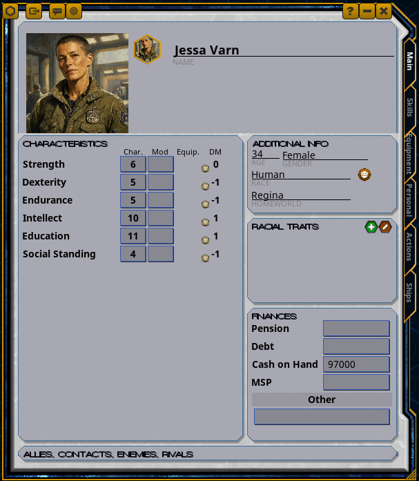

# Kraken Big Portraits Traveller

A big character portrait (148 x 148) at the top of the Traveller character sheet. The frame shows the full-size picture the player chose, not the small character-list copy, and follows changes; a book pregen shows its own picture. The chat and character-list portraits use matching frames.

Made from Big Portraits 3.5E (itself from Zarestia's Big Portraits).

## Install

Copy the `KrakenBigPortraitsTraveller` folder into your Fantasy Grounds `extensions` folder and tick
**Kraken Big Portraits Traveller** in a Traveller campaign.

## Changelog

## 1.0.0 (2026-10-23)

- First release: big portraits for Traveller.
